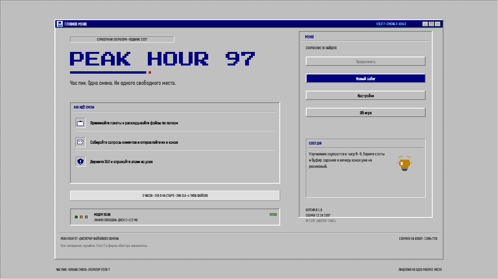
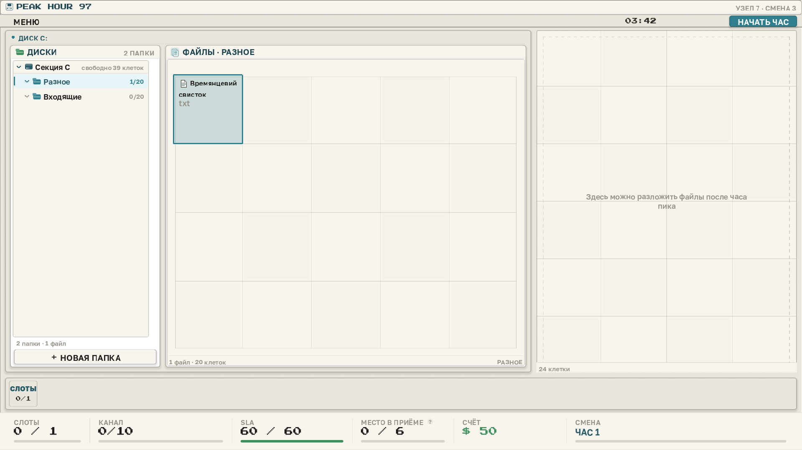
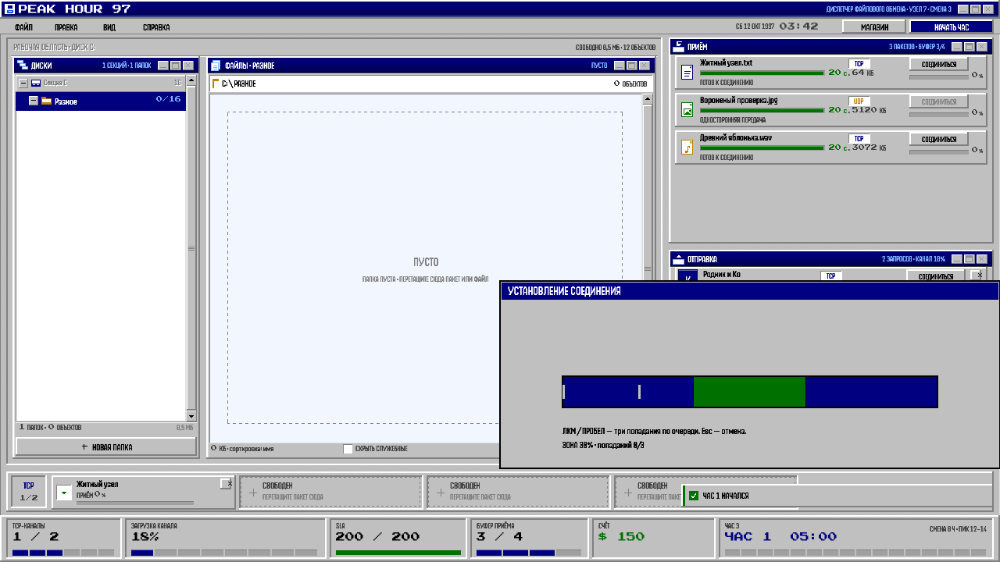
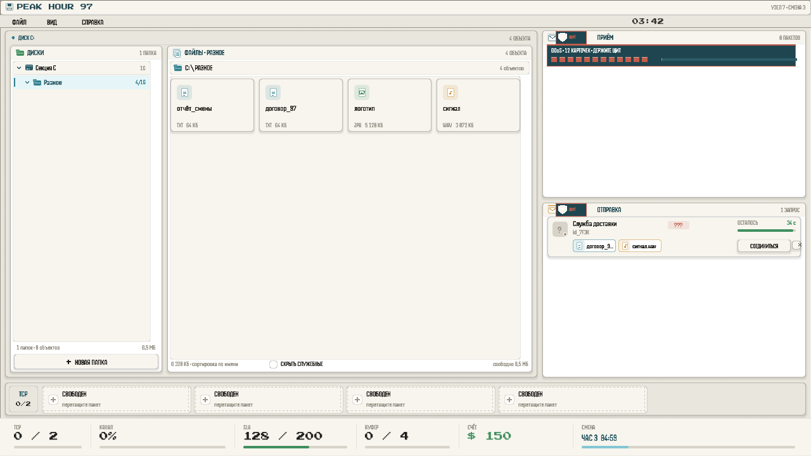
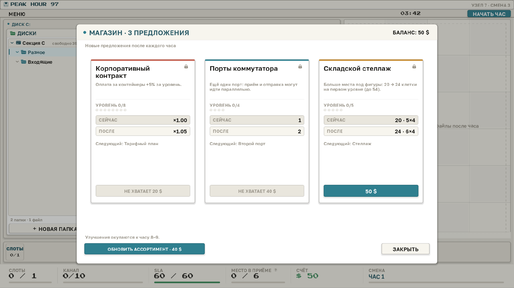
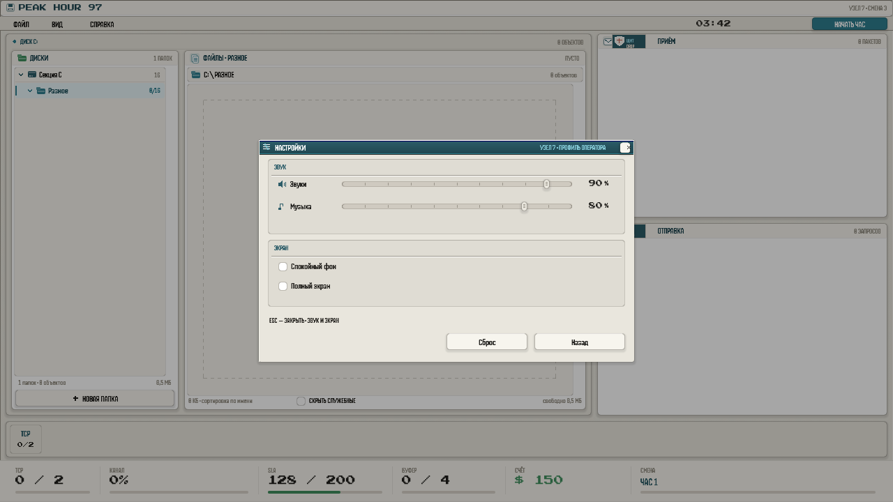

# PEAK HOUR 97

**Платформа:** Web (HTML5, Godot 4.7.2)
**Жанр:** менеджмент / тайм-менеджмент, retro UI
**Длительность:** 9 игровых часов — от 2 до 6 минут (120 → 360 с), всего
около 36 минут + подготовка между часами
**Язык:** русский
**Управление:** мышь и клавиатура
**Окно:** 1920×1080, логический viewport 1280×720

## Короткое описание

1997 год. Ночная смена в узле файлового обмена. Принимайте пакеты,
раскладывайте файлы по папкам, отправляйте контейнеры клиентам, держите
SLA — и не дайте атакам положить канал.

## Описание

Вы — дежурный оператор узла 7. В 03:42 на столе мигает приём: пакеты
приходят быстрее, чем вы успеваете разложить их по папкам. Каждый файл —
фигура из клеток: текст занимает одну, видео — четыре. Фигуру можно
повернуть и плотно уложить в сетку папки; на столе сортировки всегда есть
место, чтобы разобраться с завалом.

Клиенты присылают запросы на 1–4 конкретных файла — их имена видны на
карточке, и прикрепить нужно именно этот файл. Соберите контейнер, выберите
протокол — TCP платит больше, UDP быстрее — и нажмите «ПОДКЛЮЧИТЬСЯ» (TCP) или
«ОТПРАВИТЬ». TCP сначала требует провести три палочки через зелёную зону и
занимает слот соединения; до этого файлы в запрос не прикрепляются. После
соединения отправку запускает отдельная кнопка, а после успешной отправки
слот остаётся занятым, пока вы не нажмёте «ОТКЛЮЧИТЬ». UDP соединяется сразу,
но в конце передачи может потерять пакет: тогда −3 SLA, файлы остаются, а
повтор — через 4 секунды. Отправка не абстрактная: перед ней открывается
мини-игра. Всего их десять: шесть для отправки и четыре для атак, у отправки
три ступени, у атак четыре. В них нет таймеров — только конечная цель и
качество выполнения, от которого зависит выплата. Результат показывает
проценты, вердикт и детали, а награда применяется после «ПРОДОЛЖИТЬ».

Смена длится девять игровых часов: первый — две минуты, каждый следующий на
тридцать секунд длиннее, финальный — шесть минут; всего около **36 минут**
плюс подготовка. Каждый час приносит больше файлов и запросов, а атаки
приходят в своё окно внутри часа. Файлы после отправки не исчезают: они
остаются в папках и могут понадобиться следующим клиентам. На старте
**SLA 60/60**, кап растёт до 220; в начале часа восстанавливается 15 SLA.
Потерянный пакет бьёт по типу файла: текст 2, звук 4, фото 8, видео 16.
Первый час проходит без атак; дальше в узел лезут мусор, DDoS, фишинг и
шифровальщик. Каждая атака — это отдельная мини-игра, которая ставит час на
паузу: отбейте её, и получите деньги и SLA; провалите — получите штраф и
временный дебафф. «Заземление» гасит атаку автоматически, но приносит 70 %
награды.

Магазин открывается после первого часа: **9 улучшений** — порты, оптика,
ИБП, заземление, контракты, стеллажи, канал, регламент и UDP-повторитель.
Каждую подготовку предлагаются три лота; ассортимент можно обновить за
40/80/120 $ или закрепить нужное предложение. Полное дерево стоит **8 825 $** —
выкупить всё за один забег не получится, придётся выбирать.

Дожить до конца смены — победа; уронить SLA — поражение. Сохранение
работает между часами, включая офферы магазина и стол сортировки.

Интерфейс вдохновлён Kaleidos: тёплая бумага, тонкие 1 px контуры, мягкие
тени и бирюзовый акцент. В первом часу БАЙТ ведёт пошаговый туториал:
пакет → прикрепление → TCP-соединение → мини-игра → SLA и атаки; шаг можно
пропустить кнопкой «ДАЛЕЕ», а повторить обучение — кнопкой «ОБУЧЕНИЕ» в
меню. В главном меню — лёгкий VHS-эффект, который отключается в настройках;
в игре UI остаётся чистым. Фон — ambient машинного зала, включается после
первого жеста и регулируется вместе с музыкой.

Тело интерфейса набрано Kechusilka Regular (fallback — Golos Text), крупный
текст — DisplayOTF, Press Start 2P — цифры и счётчики; иконки файлов —
пиксельные, из `art/icons/`. В меню-баре вместо часов — термометр «ЖАРА»:
он показывает, насколько раскалён узел, а по краям экрана копится тёплый
градиент. Эффекты движения отключаются галочкой «Снизить эффекты». Звуки
синтезированы скриптом проекта. Собрано на
Godot 4.7.2 для Web без threads: игра запускается в браузере без COOP/COEP.
Это играбельный джем-прототип полного цикла: меню, подготовка, девять часов,
итоги, магазин, пауза, настройки, атаки, сохранение и мета-открытия.

## Управление

| Действие | Ввод |
| --- | --- |
| Выбор, меню, перетаскивание | ЛКМ |
| Контекстное меню | ПКМ |
| Поворот фигуры во время drag | R или ПКМ |
| Пакет из «Приёма» → папка | drag&drop |
| Файл из папки → карточка запроса | drag&drop (TCP — только после соединения) |
| Файл ↔ стол сортировки | drag&drop |
| TCP-соединение | кнопка «ПОДКЛЮЧИТЬСЯ», 3 попадания в зелёную зону |
| Отправка контейнера | кнопка «ОТПРАВИТЬ» |
| Отклонить запрос | кнопка «ОТКЛОНИТЬ» |
| Закрыть TCP-соединение | «ОТКЛЮЧИТЬ» на слоте |
| Открепить файл | двойной клик по чипу |
| TCP / UDP | переключатель на карточке запроса до соединения |
| Мини-игра: действие | ЛКМ / Space / стрелки |
| `dots`: линия | нажать на «С» и вести курсор по клеткам |
| Пропустить мини-игру | «ПРОПУСТИТЬ»/«СДАТЬСЯ» + второй клик |
| Результат мини-игры | «ПРОДОЛЖИТЬ» или Esc |
| Пауза | Esc |

## Сделано на FEIS Game Jam

FEIS Game Jam, 2026. Команда — 4 человека. Godot 4.7.2, GDScript, Web
(HTML5, no threads), 1920×1080, RU-only. Дедлайн — 26.10.2026.

## ИИ

Код, тесты, баланс, документация и звук создавались с ИИ-ассистентами
(OpenCode + субагенты). Идея, логлайн, исходная спецификация и финальная
приёмка — человеком. Полный отчёт: [AI_REPORT.md](https://git.194-146-38-78.sslip.io/admin/Game-JAM/-/blob/main/AI_REPORT.md).

## Ассеты и лицензии

Шрифты **Golos Text** и **Press Start 2P** — SIL OFL 1.1; **Kechusilka** —
лицензия подтверждена владельцем проекта; **DisplayOTF** — freeware/personal
(Denis A Serikov). UI, пиксельные иконки (`art/icons/`), маскот **БАЙТ** и
icon.svg сделаны командой — MIT. SFX и hum.wav сгенерированы скриптом проекта
— MIT/CC0. Код — MIT. Полный список и инструкции по воспроизведению:
[ASSETS.md](https://git.194-146-38-78.sslip.io/admin/Game-JAM/-/blob/main/ASSETS.md).

## Ссылки

- Репозиторий: https://git.194-146-38-78.sslip.io/admin/Game-JAM
- GDD: https://git.194-146-38-78.sslip.io/admin/Game-JAM/-/blob/main/docs/GDD.md
- Решения: https://git.194-146-38-78.sslip.io/admin/Game-JAM/-/blob/main/docs/DECISIONS.md

## Скриншоты

1. **Главное меню.** «Главное меню: новый забег, настройки, продолжение сохранённой смены».

2. **Подготовка.** «Подготовка: сетка папок, стол сортировки 4×6, SLA 60/60; магазин откроется после первого часа».

3. **Час пик.** «Час пик: пакеты-фигуры в приёме и запросы с таймерами, протоколами и слотами».

4. **Атаки.** «Мини-игра атаки: час на паузе, качество и вердикт после действия».

5. **Магазин.** «Магазин после часа: три предложения, реролл и замок, без крестика».

6. **Настройки.** «Настройки: звук, спокойный фон, полный экран».

## Теги

godot game jam management simulation retro 90s pixel art singleplayer short web

---

## Перед публикацией (служебное, в текст страницы не вставлять)

- [ ] Пересобрать build/web из текущего кода и загрузить в itch.io:
      HTML5, 1920×1080, без fullscreen-lock.
- [ ] Пересобрать скриншоты под v3 (запросы с именами файлов, TCP-полоска,
      иконки, сетка 9×6, 3 оффера) и загрузить 6 кадров из docs/screenshots/:
      обязательные — main_menu.png, hour.png, attacks.png; дополнительно —
      prep.png, shop.png, settings.png; cover.png (630×500) — обложка страницы.
- [ ] Сверить ссылку на репозиторий и ветку (main); при другой ветке
      заменить main на фактическую.
- [ ] Прогнать полный забег вручную на itch.io, проверить сохранение после
      перезагрузки вкладки.
- [ ] Отправить страницу и сборку в джем.
